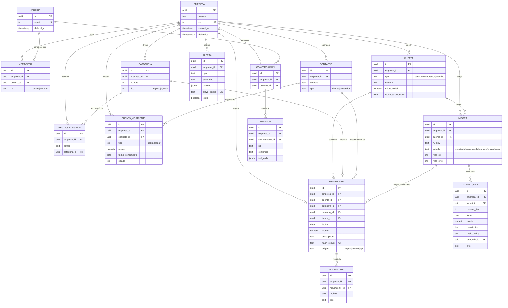

# Modelo de datos — Helpyme

Implementación tipada en
[`packages/db/src/schema.ts`](../../packages/db/src/schema.ts). Este documento
explica el *porqué*; el esquema es la fuente de verdad.

---

## 1. Regla de oro

> **Toda tabla de negocio lleva `empresa_id`. Toda consulta filtra por
> `empresa_id`.**

Esa es la garantía de aislamiento multi-tenant. No es una convención de estilo:
es el invariante del que depende que una PyME no vea la plata de otra. Las
únicas tablas sin `empresa_id` son `empresa` y las de identidad (`usuario`,
sesiones), donde la pertenencia se expresa en la membresía
([ADR-0012](./adr/0012-empresa-es-la-organizacion.md)).

**La regla no tiene excepciones por conveniencia.** `mensaje` repite el
`empresa_id` de su conversación para poder filtrarse sin pasar por otra tabla.
Un test recorre el catálogo de la base y falla si aparece una tabla sin
`empresa_id` que no esté declarada como de identidad
([`migraciones.test.ts`](../../packages/db/test/migraciones.test.ts)).

---

## 2. Diagrama entidad-relación



`MEMBRESIA` y el resto de las tablas de Better Auth todavía no están en
`schema.ts`: las genera su CLI al implementar la autenticación. El diagrama la
muestra porque es donde quedó la relación entre usuario y empresa
([ADR-0012](./adr/0012-empresa-es-la-organizacion.md)).

---

## 3. Decisiones de modelado que hay que poder defender

### 3.1 `numeric`, nunca `float`, para dinero

Los montos se almacenan como `numeric(14, 2)`. Un `double precision` no puede
representar `0.1` exactamente, y en un producto financiero los errores de
redondeo se acumulan hasta que un total no cierra contra el extracto del banco.
`numeric` es aritmética decimal exacta.

En TypeScript, Drizzle devuelve `numeric` como **string**, no como `number`, y
eso es deliberado: forzar la conversión explícita evita que un `Number()`
silencioso reintroduzca el error de punto flotante. Los cálculos monetarios se
hacen en SQL, donde la precisión está garantizada.

### 3.2 `hash_dedup` con índice único por empresa

El usuario va a subir extractos con períodos solapados —es el comportamiento
normal, no un error. La deduplicación se resuelve con un hash de
`(fecha + monto + descripción normalizada)` y un **índice único sobre
`(empresa_id, hash_dedup)`**.

Que la restricción viva en la base y no en la aplicación importa: un
`SELECT ... IF NOT EXISTS ... INSERT` es una condición de carrera cuando dos
imports corren en paralelo. Con el índice único, el `INSERT ... ON CONFLICT DO
NOTHING` es atómico.

El hash incluye `empresa_id` en su ámbito por el índice compuesto: dos empresas
distintas pueden legítimamente tener el mismo movimiento.

**Dos movimientos idénticos en el mismo día también son legítimos**: dos cobros
del mismo importe, dos viajes iguales. Para que no colisionen, el hash incluye
el **número de ocurrencia** de esa combinación dentro del archivo: la primera
vez que aparece lleva 1, la segunda 2. Dos extractos solapados numeran igual
las mismas filas, así que la deduplicación sigue funcionando. Límite conocido:
si dos extractos cortan el mismo día en puntos distintos y cada uno trae una
sola de las dos operaciones, ambas reciben el número 1 y la segunda se pierde.
Los extractos cortan por día completo; el caso queda documentado.

La deduplicación ocurre **al confirmar el import**, que es cuando las filas
pasan a `movimiento` (§3.8).

### 3.3 `categoria_id` es nullable — a propósito

Un movimiento sin categorizar es un estado **válido y visible**, no un error a
esconder. El dashboard muestra un contador de «movimientos sin categorizar»
porque una categorización incorrecta propaga error a todos los indicadores. Es
preferible que el usuario vea que faltan 12 movimientos por clasificar a que el
sistema los meta en «Otros» y muestre un resultado que parece completo.

### 3.4 `mensaje.tool_calls` en `jsonb`

Se persiste **qué funciones invocó el modelo y con qué argumentos** en cada
turno. Sirve para tres cosas: reconstruir la conversación en el turno siguiente
(el runtime no tiene estado en memoria), auditar que una cifra dada al usuario
provino de una función real, y depurar cuando el modelo elige mal la
herramienta.

Es la contracara técnica del `AI-DECISIONS.md`: trazabilidad de lo que hizo la
IA, esta vez en tiempo de ejecución.

### 3.5 Documentos por referencia, no por contenido

`documento` guarda una `r2_key`, no el archivo. Postgres almacena metadatos;
R2 almacena bytes. Meter binarios en la base infla los backups, encarece cada
consulta y desperdicia el almacenamiento más caro del stack en el dato más
frío.

Los originales se conservan **por trazabilidad**: si un cálculo se cuestiona, se
puede volver al extracto tal como lo subió el usuario.

### 3.6 El historial no se borra: borrado lógico y `ON DELETE`

Un dato financiero que desaparece no se puede auditar. La regla tiene dos
partes:

- **La baja es lógica.** `empresa` y `usuario` tienen `deleted_at`: darlos de
  baja marca la fila, no la elimina. El MVP no tiene ninguna operación que
  borre un movimiento; si se agrega, será lógica también.
- **La base impide el borrado físico por arrastre.** Las claves foráneas
  hacia `empresa` eran `ON DELETE CASCADE`: un `DELETE` de una empresa se
  llevaba todo su historial sin avisar. Ahora son `RESTRICT` y ese `DELETE`
  falla.

| Relación | Política | Por qué |
|---|---|---|
| Toda tabla → `empresa` | `RESTRICT` | Una empresa con datos no se borra físicamente |
| `movimiento` → `cuenta` | `RESTRICT` | Borrar una cuenta no puede llevarse sus movimientos |
| `conversacion` → `usuario` | `RESTRICT` | Las conversaciones son el registro de auditoría del asesor |
| `movimiento` → `categoria`, `contacto`, `import` | `SET NULL` | El movimiento sobrevive y queda sin clasificar, que es un estado visible |
| `regla_categoria` → `categoria` | `CASCADE` | La regla es configuración de su categoría, no historial |
| `import_fila` → `import`, `mensaje` → `conversacion` | `CASCADE` | Son parte de su padre: no existen sin él |

`CASCADE` queda solo donde la fila hija es una parte de la madre.

La eliminación definitiva de los datos de una empresa dada de baja es otra
operación, explícita y ordenada, que se define con la política de retención
([06-seguridad §8](./06-seguridad.md)).

### 3.7 El saldo necesita un punto de partida

Sumar los movimientos importados da el flujo del período, no el saldo: falta lo
que había antes del primer extracto. Por eso `cuenta` tiene `saldo_inicial` y
`fecha_saldo_inicial`:

> saldo de la cuenta = `saldo_inicial` + movimientos con fecha posterior a
> `fecha_saldo_inicial`

El saldo se ancla a una fecha, y no «al primer movimiento», para que subir
después un extracto más viejo no lo altere: esos movimientos entran al análisis
de ingresos y egresos, pero no al saldo.

Los dos campos son opcionales y **van juntos o no van**, lo que garantiza una
restricción `CHECK`. Una cuenta sin saldo inicial declarado es un estado válido
y visible, igual que un movimiento sin categoría (§3.3): la interfaz dice que
falta ese dato en lugar de mostrar un número que parece un saldo y no lo es. El
saldo consolidado es la suma de las cuentas que lo tienen declarado.

### 3.8 Las filas de un import no son movimientos

El consumidor de la cola escribe las filas interpretadas en `import_fila`. Pasan
a `movimiento` recién cuando el usuario confirma, con un solo
`INSERT … SELECT … ON CONFLICT DO NOTHING`.

La consecuencia es el invariante más útil de la capa de cálculo: **toda fila de
`movimiento` cuenta**. Ninguna consulta tiene que acordarse de excluir datos sin
revisar. Las alternativas descartadas están en
[ADR-0014](./adr/0014-staging-de-imports.md).

`import_fila` guarda también las filas que no se pudieron interpretar, con su
motivo. Una restricción `CHECK` asegura que cada fila sea válida o traiga su
error, nunca ninguna de las dos.

### 3.9 `contacto_id` en el movimiento, nullable

Sin esa referencia no se puede responder «a quién le pago más», que es una de
las siete herramientas del asesor. Es nullable por el mismo motivo que la
categoría: un extracto bancario no trae el proveedor, y un movimiento sin
proveedor asignado es un estado válido y visible.

No lleva índice propio. El ranking por proveedor es siempre de un período, así
que lo resuelve el índice `(empresa_id, fecha)`; agregar otro sería
especulativo (§4).

### 3.10 `alerta.clave_dedup`

El cron evalúa las reglas todos los días sobre los mismos datos. Sin una
identidad para «el hecho que disparó la alerta», cada corrida repetiría las de
la anterior.

`clave_dedup` es esa identidad: la regla, la entidad y el período, por ejemplo
`desvio_gasto:2026-10`. Con el índice único `(empresa_id, clave_dedup)`, el cron
inserta con `ON CONFLICT DO NOTHING` y dos corridas dejan el mismo resultado.
Es lo que hace reproducibles a las alertas
([02-diagramas §4](./02-diagramas.md)).

---

## 4. Índices previstos

El acceso siempre es «una empresa, un rango de fechas», así que los índices lo
reflejan.

| Tabla | Índice | Motivo |
|---|---|---|
| `movimiento` | `(empresa_id, fecha DESC)` | Listados y agregaciones del dashboard, que son el 80 % de las lecturas |
| `movimiento` | `UNIQUE (empresa_id, hash_dedup)` | Deduplicación atómica al confirmar un import |
| `movimiento` | `(empresa_id, categoria_id)` | Distribución de gastos por categoría |
| `import_fila` | `UNIQUE (import_id, numero_fila)` | Previsualización de un import; reentregar el mensaje de la cola no duplica filas |
| `cuenta_corriente` | `(empresa_id, fecha_vencimiento)` | Proyección de caja y alertas de vencimiento |
| `alerta` | `(empresa_id, leida, created_at DESC)` | Bandeja de alertas no leídas |
| `alerta` | `UNIQUE (empresa_id, clave_dedup)` | Correr el cron dos veces no duplica alertas |
| `mensaje` | `(conversacion_id, created_at)` | Reconstrucción del historial en cada turno |
| `usuario` | `UNIQUE (email)` | Login |

Ninguno de estos índices es especulativo: cada uno corresponde a una consulta
concreta de la capa de cálculo descrita en
[01-arquitectura.md](./01-arquitectura.md#32-capa-de-cálculo--determinística).

---

## 5. Migraciones

Se versionan con **Drizzle Kit** y viven en `packages/db/drizzle/`.

```bash
npm run db:generate    # genera el SQL a partir del cambio en schema.ts
npm run db:migrate     # aplica las migraciones pendientes
```

Reglas del equipo:

1. **El SQL generado se commitea.** Es parte del historial revisable; un
   reviewer tiene que poder ver qué le pasa a la base en ese PR.
2. **Nunca se edita una migración ya mergeada a `main`.** Si está mal, se
   agrega una nueva que corrija.
3. **Toda migración se prueba primero en la branch de Neon del desarrollador**
   y la vuelve a aplicar el CI sobre una branch efímera creada desde `main`,
   que tiene el mismo esquema que producción
   ([ADR-0013](./adr/0013-preview-compartido.md)).
4. **Un solo PR de esquema abierto a la vez.** Dos ramas que regeneran el
   snapshot de Drizzle chocan entre sí.
