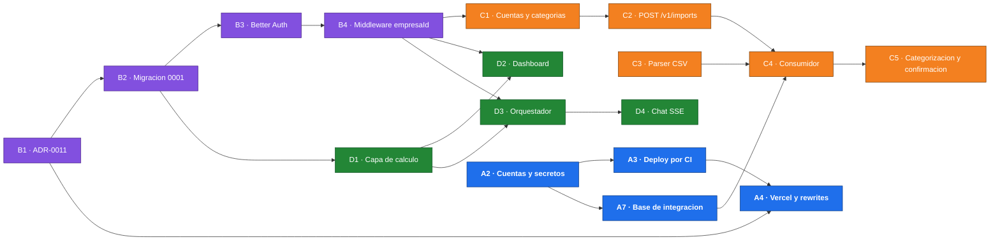

# Plan de trabajo — Checkpoint 2

> **Hito:** Checkpoint 2 del TPI · **Entrega:** lunes 09/11/2026
> **Escrito el:** 11/10/2026, a cuatro semanas de la entrega
> **Seguimiento:** [milestone «Checkpoint 2»](https://github.com/colosoler/Helpyme/milestone/1)
> y tablero Kanban ([08-proceso-equipo](../../docs/08-proceso-equipo.md))

La consigna pide para este hito una *«Demo Funcional (pre-entrega): sistema con
infraestructura desplegada, backend operativo y pruebas de integración»*. Este
documento define qué entra, cómo se reparte y en qué orden se hace.

---

## 1. Punto de partida

Estado del repositorio al 11/10/2026, contrastado con lo que pide el hito:

| Requisito de la consigna | Estado al 11/10 |
|---|---|
| **Infraestructura desplegada** | Declarada como código (`wrangler.toml`, esquema Drizzle, workflow de CI) pero **sin desplegar**: no hay cuentas provisionadas, secretos ni entorno `production`, y el job de deploy está apagado. |
| **Backend operativo** | Solo el esqueleto: `/health` y `/ready`. No hay autenticación ni rutas `/v1`; el consumidor de la cola reintenta todos los mensajes a propósito y el cron no evalúa reglas. |
| **Pruebas de integración** | 29 tests unitarios (13 de la API, 16 de contratos). Corren en Node con dependencias inyectadas, no contra el runtime de Workers ni contra una base real. |

Además, el proceso de equipo de
[08-proceso-equipo](../../docs/08-proceso-equipo.md) todavía no estaba en
marcha: el ruleset de `main` estaba creado pero deshabilitado y no había issues
cargados.

---

## 2. Alcance

No entran las once funcionalidades del MVP. Entra un **camino de demo** que
recorre el producto de punta a punta, más lo que el tiempo permita.

| Nivel | Funcionalidades |
|---|---|
| **Obligatorio** — camino de demo | F1 registro y autenticación · F3 carga de extractos (CSV) · F5 categorización · F7 dashboard · F10 asesor conversacional. Todo desplegado y con pruebas de integración. |
| **Extra** — si da el tiempo | F4 carga manual · F6 cuentas por cobrar y pagar · F8 proyección de caja · F9 alertas por reglas |
| **Pasa a la Defensa Final** | F2 Mercado Pago · F11 simulador · extractos XLSX · pulido del frontend |

**Guion de la demo**, que tiene que funcionar en producción:

1. Registrarse y crear la empresa.
2. Subir un extracto CSV.
3. Ver el import procesarse, corregir una categoría y confirmar.
4. Ver el dashboard con esos movimientos.
5. Preguntarle al asesor y que responda con las mismas cifras del dashboard.

**Por qué este recorte.**

- **El asesor no se posterga.** La consigna hace obligatoria la integración de
  IA y es el diferencial del producto: llegar al checkpoint sin F10 sería
  mostrar un sistema convencional.
- **Mercado Pago depende de un tercero.** El alta de la aplicación, las URL de
  redirección y las cuentas de prueba no dependen del equipo. No conviene
  ponerlo en el camino de un hito con fecha fija.
- **Entre el Checkpoint 2 y la Defensa Final hay solo tres semanas.** Todo
  extra que no llegue se suma a F2 y F11 en ese tramo. Por eso los extras no
  son opcionales en espíritu: se toman apenas el camino de demo esté cerrado.

---

## 3. Huecos a cerrar en la semana 1

Inconsistencias entre la documentación, el esquema y lo ya decidido,
encontradas al releer todo para armar este plan. Varias bloquean F1 o F3.

| # | Hueco | Se resuelve en |
|---|---|---|
| 1 | **Cookies entre sitios.** El frontend (`*.vercel.app`) y el Worker (`*.workers.dev`) son sitios distintos: la cookie `SameSite=Lax` de [06-seguridad §2](../checkpoint-1/06-seguridad.md) no viaja en un `fetch` entre ellos. Recomendación: *rewrites* de Next (`/api/*` → Worker) para que la sesión sea *first-party*. | [#12], [#5] |
| 2 | **`usuario.empresa_id` sigue en `schema.ts`**, aunque [`AI-DECISIONS.md`](../../AI-DECISIONS.md) registra que se decidió quitarlo y usar la membresía de Better Auth. Faltan también `deleted_at` y la revisión de los `ON DELETE CASCADE`. | [#12], [#13] |
| 3 | **Confirmación del import.** El consumidor inserta movimientos antes de que el usuario confirme, y `estado_import` no tiene `confirmado`: contarían en el dashboard sin revisar. | [#13], [#22] |
| 4 | **`getGastosPorProveedor` no se puede calcular**: `movimiento` no referencia a `contacto`. | [#13] |
| 5 | **«Saldo consolidado» sin definir**: `cuenta` no tiene saldo inicial. | [#13] |
| 6 | **`alerta` sin clave de idempotencia**: el cron diario duplicaría alertas. | [#13] |
| 7 | **La documentación promete una branch de Neon por PR**; la realidad es un entorno de preview compartido ([02-diagramas §2](../checkpoint-1/02-diagramas.md), [04-infraestructura §5](../checkpoint-1/04-infraestructura.md), [03-modelo-datos §5](../checkpoint-1/03-modelo-datos.md)). | [#12] |
| 8 | **Dos movimientos legítimos idénticos en el mismo día** tienen el mismo `hash_dedup` y uno se descartaría. | [#20] |
| 9 | Menores: `GEMINI_MODEL` no está en `Bindings` ni en `wrangler.toml`; el script `lint` no ejecuta nada; Dependabot está deshabilitado; los dominios de CORS son supuestos. | [#27], [#6], [#5] |

**Regla del hito: un solo PR de esquema abierto a la vez.** Dos ramas que
regeneran el snapshot de Drizzle chocan entre sí. Los huecos 2 a 6 van juntos
en la migración `0001` ([#13]).

---

## 4. Frentes de trabajo

Cuatro frentes, uno por integrante. Cada frente tiene un dueño que responde por
él en la defensa, y **sus PR los revisa alguien de otro frente**: es lo que
reparte el conocimiento y deja la evidencia de revisión cruzada que pide la
consigna.

| Frente | Dueño | Qué incluye |
|---|---|---|
| **A · Plataforma** | A definir | Cuentas y secretos, deploy por CI, Vercel, base de las pruebas de integración, rate limiting, observabilidad |
| **B · Identidad** | A definir | ADR-0011, migración `0001`, Better Auth con organizaciones, middleware de `empresaId`, tests de aislamiento, login |
| **C · Ingesta** | A definir | `POST /v1/imports`, parser CSV, consumidor de la cola, `hash_dedup`, categorización y confirmación, pantalla de carga |
| **D · Cálculo y asesor** | A definir | Capa de cálculo, endpoints del dashboard, orquestador con Gemini, chat con streaming, set de evaluación, dashboard y chat |

Los dueños se definen al cerrar [#2]. Cada frente incluye su parte de frontend:
quien hace el endpoint hace la pantalla que lo usa.

### 4.1 Camino crítico

**Toda ruta `/v1` depende de la cadena B1 → B2 → B3 → B4.** Para que los
frentes C y D no queden esperando en la semana 1:

- El parser CSV ([#20]) no tiene dependencias: es texto de entrada y filas de
  salida.
- La capa de cálculo ([#25]) recibe `empresaId` como argumento y solo necesita
  el esquema.
- [#15] abre con un PR chico que solo define los tipos del contexto, para que
  los demás programen contra ese contrato.

---

## 5. Cronograma

Cada semana cierra con un hito que se verifica contra el sistema desplegado,
no contra el tablero.

| Semana | Objetivo | Hito verificable al domingo |
|---|---|---|
| **S1 · 12–18/10** | Fundaciones y deploy del esqueleto | `/ready` responde `200` en producción contra Neon; la web en Vercel muestra «API operativa»; ruleset activo y tablero con dueños |
| **S2 · 19–25/10** | Autenticación y primer corte vertical | En producción: registrarse, crear la empresa y subir un CSV que devuelve `202` |
| **S3 · 26/10–01/11** | Camino de demo completo | Import → dashboard → pregunta al asesor, de punta a punta; suite de aislamiento en verde |
| **S4 · 02–08/11** | Endurecer y juntar evidencia | Congelamiento de funcionalidades el jueves 05/11; ensayo de la demo el viernes 06/11; esta carpeta completa |

**Si un hito semanal no se cumple, lo primero que se recorta son los extras.**
El camino de demo no se negocia; su fecha, tampoco.

---

## 6. Tareas

Prioridad: **O** obligatorio, **E** extra. Tamaño según
[08-proceso-equipo §2](../../docs/08-proceso-equipo.md). El criterio de
aceptación de cada tarea está en su issue.

### Frente A · Plataforma

| Tarea | Issue | Semana | Pri. | Tam. | Depende de |
|---|---|---|---|---|---|
| A1 · Ruleset de `main` y tablero Kanban con WIP | [#2] | S1 | O | S | — |
| A2 · Provisionar Cloudflare, Neon y Gemini; secretos | [#3] | S1 | O | M | — |
| A3 · Deploy a producción por CI y smoke test | [#4] | S1 | O | S | A2 |
| A4 · Vercel con rewrites `/api/*` y CORS real | [#5] | S1 | O | M | A3, B1 |
| A5 · Lint, `npm audit` y Dependabot | [#6] | S2 | O | S | — |
| A6 · Deploy del Worker de preview en cada PR | [#7] | S2 | O | S | A3, A4 |
| A7 · Base de pruebas de integración en `workerd` con Neon | [#8] | S1–S2 | O | M | A2 |
| A8 · Rate limiting del chat por empresa | [#9] | S3 | O | S | B4, D4 |
| A9 · `empresaId` en logs y métricas de negocio | [#10] | S3 | O | S | B4, C4, D4 |
| A10 · Dashboards y alertas operativas con evidencia | [#11] | S4 | O | M | A3, A9 |

### Frente B · Identidad

| Tarea | Issue | Semana | Pri. | Tam. | Depende de |
|---|---|---|---|---|---|
| B1 · ADR-0011 y corrección de la documentación | [#12] | S1 | O | S | — |
| B2 · Migración `0001` | [#13] | S1 | O | M | B1 |
| B3 · Better Auth con organizaciones en el Worker | [#14] | S1–S2 | O | M | B1, B2 |
| B4 · Middleware de `empresaId` y capa de datos | [#15] | S2 | O | M | B3 |
| B5 · Suite de aislamiento multi-tenant | [#16] | S3 | O | M | A7, B4, C2, D3 |
| B6 · Registro, login y layout autenticado | [#17] | S2 | O | M | A4, B3 |

### Frente C · Ingesta

| Tarea | Issue | Semana | Pri. | Tam. | Depende de |
|---|---|---|---|---|---|
| C1 · Cuentas y categorías por defecto | [#18] | S2 | O | S | B2, B4 |
| C2 · `POST /v1/imports` y consulta de estado | [#19] | S2 | O | M | B4, C1 |
| C3 · Parser CSV, normalización y `hash_dedup` | [#20] | S1–S2 | O | M | — |
| C4 · Consumidor de la cola, idempotente | [#21] | S3 | O | M | A7, B2, C2, C3 |
| C5 · Categorización por reglas y confirmación | [#22] | S3 | O | M | B2, C4 |
| C6 · Pantalla de carga y previsualización | [#23] | S3 | O | M | B6, C2, C5 |
| C7 · Carga manual con adjunto (F4) | [#24] | S4 | E | M | B4, C1 |

### Frente D · Cálculo y asesor

| Tarea | Issue | Semana | Pri. | Tam. | Depende de |
|---|---|---|---|---|---|
| D1 · Capa de cálculo | [#25] | S1–S2 | O | M | B2 |
| D2 · Endpoints `/v1/dashboard/*` | [#26] | S2 | O | S | B4, D1 |
| D3 · Orquestador del asesor con Gemini | [#27] | S3 | O | M | B4, D1 |
| D4 · `POST /v1/chat` con streaming y `tool_calls` | [#28] | S3 | O | M | D3 |
| D5 · Set de evaluación del asesor | [#29] | S4 | O | S | D1, D4 |
| D6 · Dashboard y chat en el frontend | [#30] | S3–S4 | O | M | B6, D2, D4 |
| D7 · Cuentas por cobrar/pagar, proyección y alertas (F6, F8, F9) | [#31] | S3–S4 | E | M | B2, B4, D1 |

### Cierre

| Tarea | Issue | Semana | Pri. | Tam. | Depende de |
|---|---|---|---|---|---|
| E1 · Entregable, datos de demo y guion | [#32] | S4 | O | M | Todo lo obligatorio |

E1 no pertenece a un frente: lo toma quien esté libre en la semana 4.

---

## 7. Pruebas de integración

Es uno de los tres requisitos literales del hito, así que tiene estrategia
propia y no queda como «tests al final».

| Nivel | Qué prueba | Cómo |
|---|---|---|
| **Unitario** | Lógica pura: parser, normalización, validación de argumentos | Vitest en Node, como hoy |
| **Integración** | Una ruta o un job contra dependencias reales | En `workerd`, con R2 y Queues simulados y **PostgreSQL real en una branch efímera de Neon** que el CI crea y borra ([#8]) |
| **Asesor** | Orquestación, sin gastar tokens | Modelo falso inyectado por `AppDeps`; el set de evaluación con Gemini real corre aparte, a demanda ([#29]) |
| **Post-deploy** | Que lo desplegado responde | Smoke test de `/health` y `/ready` en el job de deploy ([#4]) |

La branch efímera por corrida hace realidad, para las pruebas, el motivo
principal de [ADR-0002](../checkpoint-1/adr/0002-persistencia-neon-postgres.md):
una copia del esquema de producción sin duplicar infraestructura.

**Casos mínimos del hito:**

- Los cuatro de aislamiento de
  [06-seguridad §1.3](../checkpoint-1/06-seguridad.md) ([#16]).
- Import de punta a punta: `202`, procesamiento por la cola y movimientos en la
  base ([#21]).
- Reimport del mismo archivo y extractos solapados: cero duplicados ([#21]).
- Totales del dashboard contra un fixture de cifras conocidas, al centavo
  ([#25]).
- `tool_calls` persistidos, con el `empresaId` de la sesión aunque el modelo
  pida otro ([#27], [#28]).

**Código que se reutiliza.** El patrón de inyección de dependencias de
[`createApp(deps)`](../../apps/api/src/app.ts) se amplía con base, auth y
cliente del modelo. Los contratos de
[`advisor-tools.ts`](../../packages/shared/src/advisor-tools.ts) y de
[`imports.ts`](../../packages/shared/src/imports.ts) no se tocan: el código
nuevo despacha contra ellos.

---

## 8. Riesgos del hito

| Riesgo | Mitigación |
|---|---|
| Better Auth necesita transacciones interactivas y el driver HTTP de Neon no las tiene | Spike de dos días al empezar [#14]. Alternativa: driver WebSocket de Neon solo para autenticación, registrado en el ADR |
| `@cloudflare/vitest-pool-workers` no es compatible con la versión de Vitest del repositorio | Spike de un día en [#8]. Alternativa: tests en Node con `app.request()` contra la branch de Neon |
| El streaming del chat queda en buffer al pasar por el rewrite de Vercel | Verificarlo en preview antes de construir el chat ([#28]) |
| Gemini Flash elige mal la función o explica flojo | Set de evaluación ([#29]); si no alcanza, ADR nuevo |
| Las cuentas pagas (Workers Paid, facturación de Gemini) demoran | Resolverlo el primer día ([#3]). En desarrollo, capa gratuita de Gemini solo con datos inventados |
| La autoría del historial quedó concentrada en pocas cuentas en el Checkpoint 1 | Un frente por integrante desde la semana 1 y revisión cruzada entre frentes |
| Todo se junta en la última semana | Hito verificable por semana, congelamiento el 05/11 y ensayo el 06/11 |
| Los extras no llegan y se acumulan para la Defensa Final | Se sabe al cierre de la semana 3: ahí se replanifica el tramo 09/11–30/11 |

---

## 9. Cuándo el Checkpoint 2 está listo

- [ ] `/ready` responde `200` en producción y el frontend está desplegado en
      Vercel.
- [ ] Cada merge a `main` despliega solo, con smoke test.
- [ ] El guion de demo de §2 funciona completo en producción.
- [ ] El job de integración está en verde en `main` e incluye los cuatro tests
      de aislamiento.
- [ ] La DLQ está vacía y las alertas operativas se probaron con un simulacro.
- [ ] El set de evaluación del asesor se corrió y su resultado está
      documentado.
- [ ] Cada entrada de [`AI-DECISIONS.md`](../../AI-DECISIONS.md) tiene su
      validación humana firmada.
- [ ] Los cuatro integrantes tienen PR propios mergeados y revisiones hechas a
      otros.
- [ ] El tablero está al día y los límites de WIP se respetaron.
- [ ] Esta carpeta tiene la evidencia de cada requisito
      ([README](./README.md)).

[#2]: https://github.com/colosoler/Helpyme/issues/2
[#3]: https://github.com/colosoler/Helpyme/issues/3
[#4]: https://github.com/colosoler/Helpyme/issues/4
[#5]: https://github.com/colosoler/Helpyme/issues/5
[#6]: https://github.com/colosoler/Helpyme/issues/6
[#7]: https://github.com/colosoler/Helpyme/issues/7
[#8]: https://github.com/colosoler/Helpyme/issues/8
[#9]: https://github.com/colosoler/Helpyme/issues/9
[#10]: https://github.com/colosoler/Helpyme/issues/10
[#11]: https://github.com/colosoler/Helpyme/issues/11
[#12]: https://github.com/colosoler/Helpyme/issues/12
[#13]: https://github.com/colosoler/Helpyme/issues/13
[#14]: https://github.com/colosoler/Helpyme/issues/14
[#15]: https://github.com/colosoler/Helpyme/issues/15
[#16]: https://github.com/colosoler/Helpyme/issues/16
[#17]: https://github.com/colosoler/Helpyme/issues/17
[#18]: https://github.com/colosoler/Helpyme/issues/18
[#19]: https://github.com/colosoler/Helpyme/issues/19
[#20]: https://github.com/colosoler/Helpyme/issues/20
[#21]: https://github.com/colosoler/Helpyme/issues/21
[#22]: https://github.com/colosoler/Helpyme/issues/22
[#23]: https://github.com/colosoler/Helpyme/issues/23
[#24]: https://github.com/colosoler/Helpyme/issues/24
[#25]: https://github.com/colosoler/Helpyme/issues/25
[#26]: https://github.com/colosoler/Helpyme/issues/26
[#27]: https://github.com/colosoler/Helpyme/issues/27
[#28]: https://github.com/colosoler/Helpyme/issues/28
[#29]: https://github.com/colosoler/Helpyme/issues/29
[#30]: https://github.com/colosoler/Helpyme/issues/30
[#31]: https://github.com/colosoler/Helpyme/issues/31
[#32]: https://github.com/colosoler/Helpyme/issues/32
